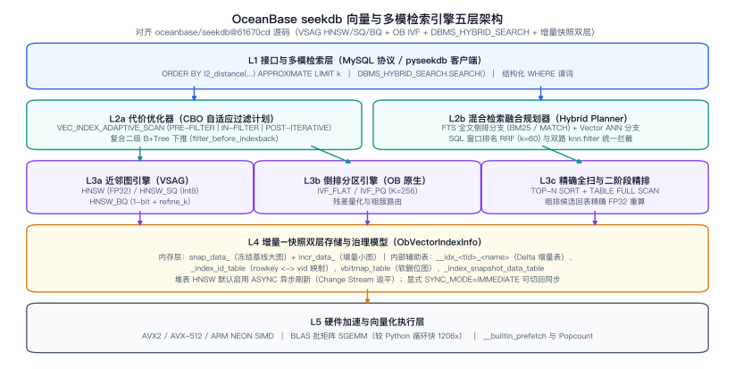
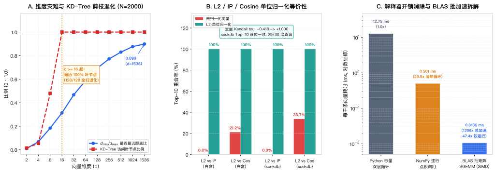
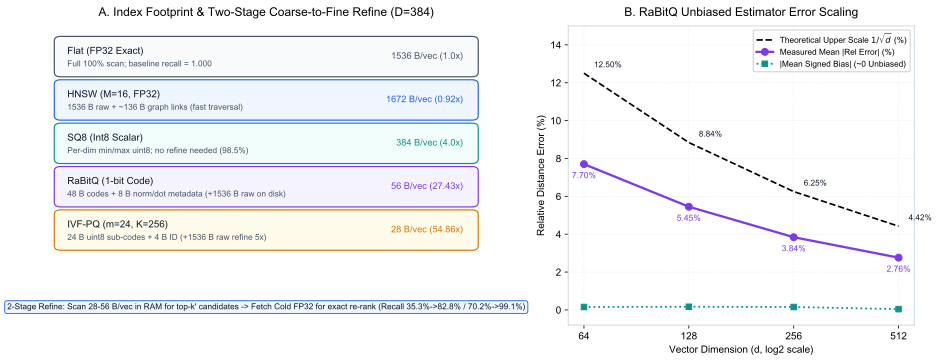
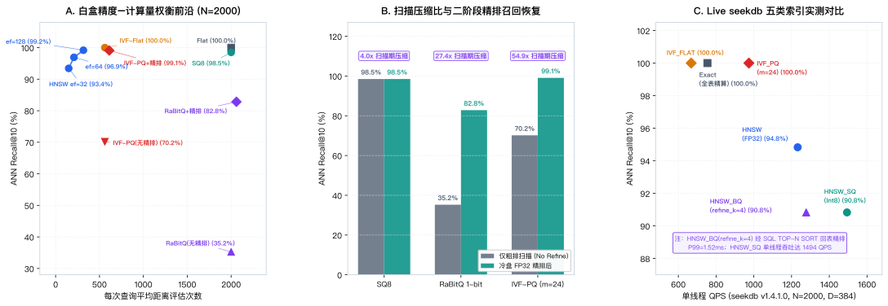
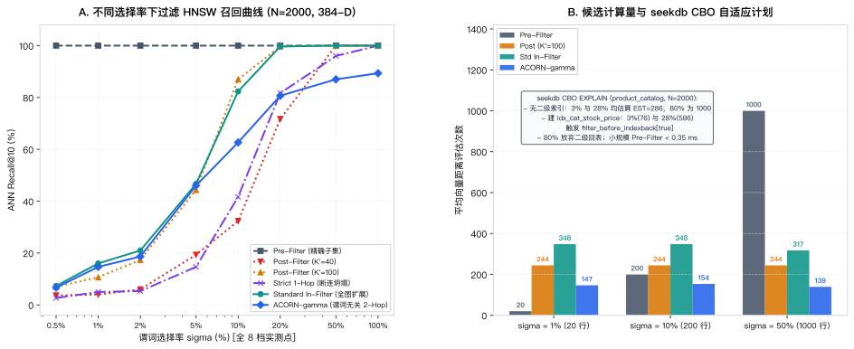
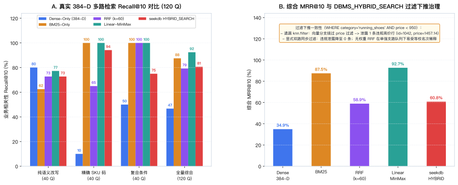
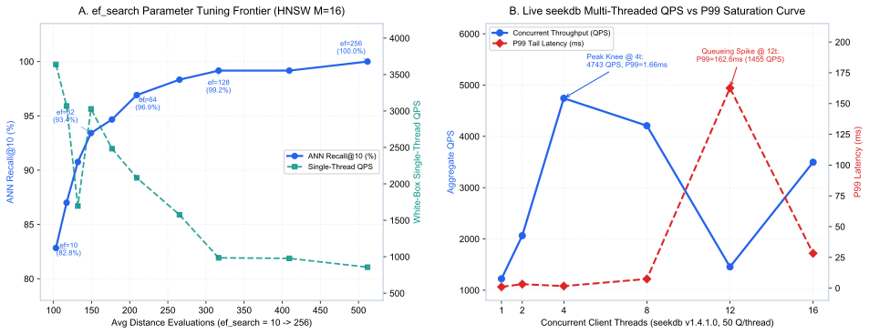
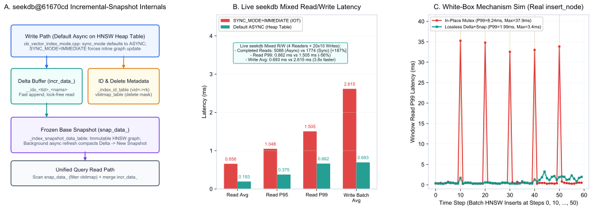

# seekdb-vector-bench

> **Mechanism Verification Benchmark Suite for Vector Databases, Quantization, Filtered ANN, Hybrid RRF, and Concurrency/Delta-Snapshot SLOs** — built on real **384-D `all-MiniLM-L6-v2` embeddings** and cross-validated against **OceanBase `seekdb` (`v1.4.1.0`, C++ source `oceanbase/seekdb@61670cd`)** and **`antgroup/vsag`**.

[](https://www.python.org/downloads/)
[](LICENSE)
[](https://github.com/oceanbase/seekdb)

---

## 1. Motivation & Design Philosophy

Rather than acting as a black-box RAG wrapper, **`seekdb-vector-bench`** isolates foundational vector database mechanisms on a unified **`product_catalog`** domain ($N=2,000$ catalog items, $384$-D normalized neural embeddings via `pyseekdb.DefaultEmbeddingFunction` [`all-MiniLM-L6-v2`], $Q=120$ queries split evenly across `semantic`, `exact_sku`, and `compound`), and cross-validates them directly against the embedded **OceanBase `seekdb` Engine (`pyseekdb` / `pylibseekdb` + `VSAG`)**:

| Experiment | Mechanism Verified | Kernel / Paper Alignment | Key Output |
| :--- | :--- | :--- | :--- |
| **Exp 1** | Curse of Dimensionality (real `InstrumentedKDTree`), L2/IP/Cosine Unit-Norm Equivalence, 3-Tier Scan Speedup | `seekdb` `l2_distance` / `cosine_distance` / `inner_product`; `vsag/src/simd` | `results/exp1_curse_of_dimensionality.csv` |
| **Exp 2** | Flat, IVF-Flat, IVF-PQ ($m=24, K=256$ + Refine), HNSW, SQ8, **RaBitQ 1-bit** & Live `seekdb` (`APPROXIMATE` vs Exact) | **SIGMOD 2024 RaBitQ**, **TPAMI 2020 HNSW**, `vsag` HNSW/SQ/BQ, OB IVF | `results/exp2_ann_quantization.csv` |
| **Exp 3** | Complete 8-Point Filtered ANN Sweep ($\sigma \in [0.5\%, 100\%]$), Predicate-Agnostic **ACORN-$\gamma$**, & `seekdb` B+Tree `EXPLAIN` | **SIGMOD 2024 ACORN**, `ob_log_table_scan.cpp:64-82`, `VECTOR INDEX ADAPTIVE SCAN` | `results/exp3_filtered_ann.csv` |
| **Exp 4** | Hybrid Search Fusion: Dense (`384-D`) vs `BM25` vs `Linear-MinMax` vs `RRF (k=60)` & `knn.filter` Leak Prevention | **SIGIR 2009 RRF**, `seekdb` `DBMS_HYBRID_SEARCH.SEARCH` / `GET_SQL` | `results/exp4_hybrid_fusion.csv` |
| **Exp 5** | `ef_search` Frontier, Live `seekdb` Multi-Threaded QPS–P99 Curve (`1t..16t`, 3-trial median), Verified Mixed R/W (10/10 rows + Live Recall) & Lossless Delta+Snapshot Sim | `ob_vector_index_mode.cpp`, `ob_plugin_vector_index_adaptor.cpp`, `ob_vector_index_util.cpp` | `results/exp5_ef_slo_curve.csv`, `results/exp5_seekdb_concurrency.csv`, `results/exp5_p99_timeseries.csv` |



---

## 2. Repository Structure

```text
seekdb-vector-bench/
├── pyproject.toml
├── run_all.py                          # Master runner (Exp 1–5 + live seekdb)
├── src/vector_bench/
│   ├── dataset.py                      # Deterministic product_catalog corpus (N=2,000, D=384 MiniLM, Q=120)
│   ├── metrics.py                      # Curse of dimensionality, InstrumentedKDTree, L2/IP/Cosine, 3-tier scan
│   ├── quantization.py                 # SQ8, standard 8-bit PQ (K=256), SIGMOD'24 RaBitQ (QR rotation + popcount)
│   ├── ann_indexes.py                  # Flat, IVF-Flat, IVF-PQ+Refine, white-box HNSW (real insert_node + gamma=2)
│   ├── filtered_ann.py                 # Pre-Filter, Post-Filter, Strict 1-Hop, Std In-Filter, predicate-agnostic ACORN-gamma
│   ├── hybrid_fusion.py                # Okapi BM25, Linear Min-Max, Rank-based RRF (k=60)
│   ├── concurrency_slo.py              # ef_search sweep, 3-trial seekdb concurrency, pure-read baseline + verified mixed R/W, Delta+Snap sim
│   └── seekdb_runner.py                # Singleton seekdb-v1.4.1.0 runner: 5 indexes, Exact vs Approx, B+Tree EXPLAIN, HYBRID
├── experiments/
│   ├── exp1_curse_and_metrics.py
│   ├── exp2_ann_and_quantization.py
│   ├── exp3_filtered_ann_collapse.py
│   ├── exp4_hybrid_rrf_vs_linear.py
│   └── exp5_slo_and_delta_snapshot_p99.py
├── scripts/generate_figures.py         # Generates unified CJK+EN b_fig1..b_fig8 as SVG & 260-DPI PNG
├── results/                            # Reproducible JSON, CSVs, and corpus_cache_384d.npz
├── docs/figures/                       # Generated b_fig1..b_fig8 SVG figures
└── tests/test_mechanisms.py            # Automated invariant test suite (pytest)
```

---

## 3. Quickstart & Reproduction

```bash
# 1. Create Python 3.11+ environment and install dependencies
uv venv --python 3.12 .venv
uv pip install --python .venv/bin/python -e ".[dev]"

# 2. Verify mathematical & algorithmic invariants
.venv/bin/pytest -v

# 3. Run all 5 experiments (including live OceanBase seekdb-v1.4.1.0 embedded engine)
.venv/bin/python run_all.py

# 4. Regenerate SVG & 260-DPI PNG figures from results/summary_metrics.json
.venv/bin/python scripts/generate_figures.py
```

---

## 4. Key Empirical Findings

### 4.1 Exp 1: Distance Concentration & Unit-Norm Equivalence
- At $d = 2$, $D_{\min}/D_{\max} = 0.0114$ and `InstrumentedKDTree` visits **`1.51%`** of `128` leaves. By **$d = 16$**, KD-Tree exact search visits **`100.0%`** (`128/128`) leaves ($D_{\min}/D_{\max} = 0.3134$); by **$d = 1536$**, $D_{\min}/D_{\max}$ rises to **`0.8987`** (relative contrast drops from `156.0135` to `0.1128`).
- On unnormalized vectors, `L2` vs `Inner Product` Top-10 overlap is **`0.0%`** (full-list Kendall-$\tau = -0.4178$) and `L2` vs `Cosine` is **`21.17%`** white-box (**`33.67%`** in live `seekdb` SQL). After L2 unit normalization ($\|x\|_2 = 1$), white-box overlap hits **`100.0%`** ($\tau = 1.0000$) and live `seekdb` achieves exact Top-10 sequence matches across **`29/30`** SQL queries.
- 3-Tier scan latency per 1,000 384-D vectors: Python scalar loop **`12.748 ms`** $\to$ row-wise NumPy **`0.501 ms`** (`25.5x`, interpreter removal) $\to$ BLAS `SGEMM` **`0.0106 ms`** (**`47.4x`** over row-wise NumPy, **`1206.1x`** over Python).



### 4.2 Exp 2: Quantization Compression Pareto & Live `seekdb` VSAG Indexes
| Implementation / Engine | Scan Footprint (B/vec) | Raw Refine Storage | Avg Evals | Recall@10 | Avg (ms) | P99 (ms) | QPS (1t) |
| :--- | :---: | :---: | :---: | :---: | :---: | :---: | :---: |
| White-box `Flat (FP32 Exact)` | 1536.0 | 0 | 2000.0 | 1.0000 | — | — | — |
| White-box `SQ8 (8-bit Scalar)` | 384.0 | 0 | 2000.0 | 0.9850 | — | — | — |
| White-box `RaBitQ 1-bit` (No Refine) | 56.0 | 0 | 2000.0 | 0.3525 | — | — | — |
| White-box `RaBitQ 1-bit + Refine(k=60)` | **56.0** (27.43x) | +1536.0 | 2060.0 | 0.8283 | — | — | — |
| White-box `IVF-PQ (m=24, K=256, Refine 5x)` | **28.0** (54.86x) | +1536.0 | 611.2 | 0.9908 | — | — | — |
| White-box `HNSW (M=16, ef=64 / 128)` | 1672.0 | 0 | 209.2 / 316.6 | 0.9692 / 0.9917 | — | — | — |
| **Live `seekdb` `Exact (No APPROXIMATE)`** | — | — | — | **1.0000** | 1.326 | 3.198 | 754.1 |
| **Live `seekdb` `HNSW (VSAG FP32)`** | — | — | — | 0.9483 | 0.811 | 2.010 | 1232.4 |
| **Live `seekdb` `HNSW_SQ (VSAG Int8)`** | — | — | — | 0.9083 | **0.669** | **1.106** | **1493.9** |
| **Live `seekdb` `HNSW_BQ (refine_k=4)`** | — | — | — | 0.9083 | 0.783 | 1.516 | 1277.6 |
| **Live `seekdb` `IVF_FLAT (OB nlist=16)`** | — | — | — | 1.0000 | 1.497 | 3.797 | 668.0 |
| **Live `seekdb` `IVF_PQ (OB nlist=16, m=24)`** | — | — | — | 1.0000 | 1.027 | 2.105 | 973.9 |

RaBitQ empirical verification confirms near-zero bias (`mean_signed_bias` within $\pm 0.17\%$ across $d \in [64, 512]$) and $O(1/\sqrt{d})$ error scaling (`7.70%` at $d=64$ $\to$ `5.45%` at $128$ $\to$ `3.84%` at $256$ $\to$ `2.76%` at $512$).




### 4.3 Exp 3: Filtered ANN Selectivity Collapse & `seekdb` B+Tree CBO Behavior
- Across all **8 selectivity levels** ($\sigma \in \{0.5\%, 1\%, 2\%, 5\%, 10\%, 20\%, 50\%, 100\%\}$), `Strict 1-Hop` collapses at low $\sigma$ (`5.00%` Recall@10 at $\sigma=1\%$) and `Pre-Filter` maintains `100.0%` recall (`0.007–0.433 ms` on $N=2,000$).
- Predicate-agnostic `ACORN-gamma` cuts distance evaluations to `144.6–153.5` (vs `347.9` for `Standard In-Filter`) while retaining `14.67%` ($\sigma=1\%$), `46.00%` ($\sigma=5\%$), and `62.67%` ($\sigma=10\%$) recall. Because neighbor-diversity RNG pruning is skipped when `gamma > 1`, `ACORN-gamma` reaches `89.33%` at $\sigma=100\%$.
- Live `seekdb` `EXPLAIN` on `product_catalog` ($N=2,000$) verifies `VECTOR INDEX ADAPTIVE SCAN (PRE-FILTER)` across 3%, 28%, and 80% selectivities (`EST.ROWS = 286/286/1000` without B+Tree; `76/586/1628` with composite `idx_cat_stock_price`, triggering `filter_before_indexback[true]` for 3% and 28%).



### 4.4 Exp 4: Multimodal Hybrid Search & `knn.filter` Leak Prevention
- Evaluated strictly with real `384-D all-MiniLM-L6-v2` embeddings and `Okapi BM25`: `Dense-Only` leads `semantic` queries (`80.12%` Recall@10, MRR `82.50%`), whereas `BM25` dominates `exact_sku` (`100.0%` vs Dense `10.00%`).
- `Linear-MinMax (alpha=0.5)` reaches **`92.42%`** overall Recall@10 (**`92.71%`** MRR@10), outperforming unweighted `RRF (k=60)` (`79.25%` Recall@10, `58.93%` MRR) and live `seekdb DBMS_HYBRID_SEARCH` (`80.64%` Recall@10, `60.79%` MRR) because unweighted $1/(60+r)$ dilutes exact SKU rank-1 hits when the dense branch assigns rank-1 scores to non-matching neighbors.
- Live `seekdb DBMS_HYBRID_SEARCH.GET_SQL` filter check: omitting `knn.filter` leaked **`1`** violating row (`id=1042, category='running_shoes', price=1457.14 >= 950`); enforcing unified `query.filter` + `knn.filter` eliminated leaks (`0`).



### 4.5 Exp 5: Concurrency QPS–P99 Knee & Verified Mixed R/W Governance
- **Live `seekdb` multi-threaded concurrency (`1t..16t`, `150` q/thread after per-connection warmup, 3-trial median)**: scales from `1361.9 QPS` (`P99=1.418 ms` at `1t`) to a low-latency knee of **`5775.2 QPS`** (`P99=1.136 ms` at `4t`), peaking at `6717.3 QPS` (`12t`, `P99=8.680 ms`) before queueing drives P99 to **`20.102 ms`** (`max 123.617 ms` at `16t`).
- **Live `seekdb` verified mixed R/W (`4` readers + `40x10` writes, `100%` 10/10 row-count assertion, `pre/post Recall@10 = 96.67% / 80.00%` matching on both tables)** & `oceanbase/seekdb@61670cd` internals:
  - `ORGANIZATION = HEAP` (`SYNC_MODE=ASYNC`) runs faster already in 4-thread pure-read baseline (`0.211 ms` / `P99=0.746 ms` via `rowset=16` vs IOT `0.777 ms` / `P99=2.390 ms` via `rowset=256`), and during concurrent writes maintains **`0.238 ms`** read avg (vs IOT `1.003 ms`), **`0.984 ms`** read P99 (vs `5.626 ms`), **`0.855 ms`** write avg (`6.9x` faster than IOT `5.913 ms`), and completes **`8,781`** reads (`3.0x` vs `2,892`).
- **White-box lossless Delta+Snapshot mechanism simulation (`800 -> 860` nodes using real `insert_node()`)**: lowers read P99 from **`8.580 ms`** (`max 59.426 ms`) under in-place RW mutex locking to **`1.828 ms`** (`max 2.946 ms`).




---

## 5. Verification & License

All core algorithmic invariants are regression-tested in [`tests/test_mechanisms.py`](tests/test_mechanisms.py) via `.venv/bin/pytest -v`. Released under the [Apache 2.0 License](LICENSE).
