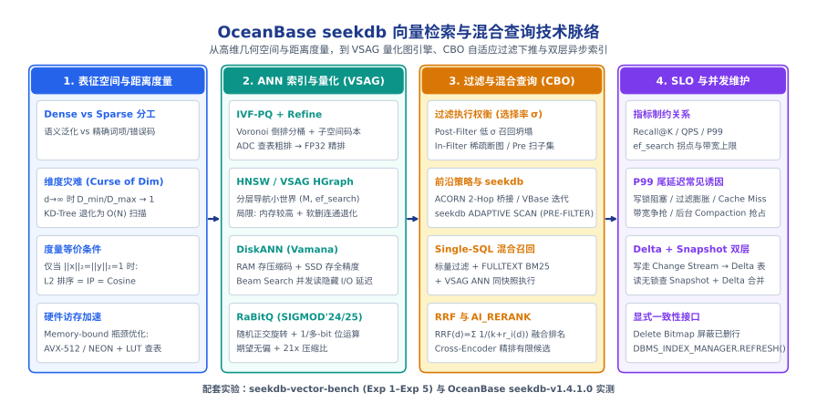
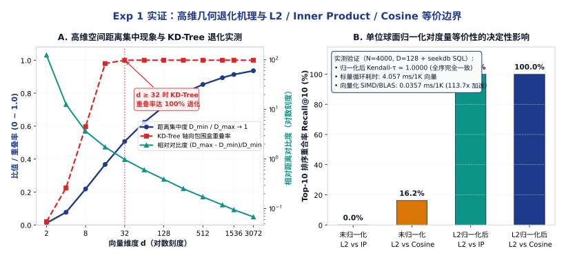
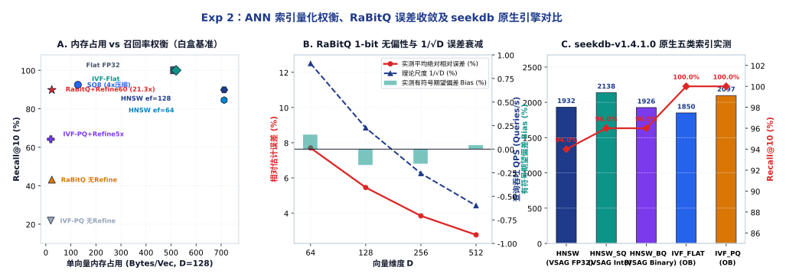
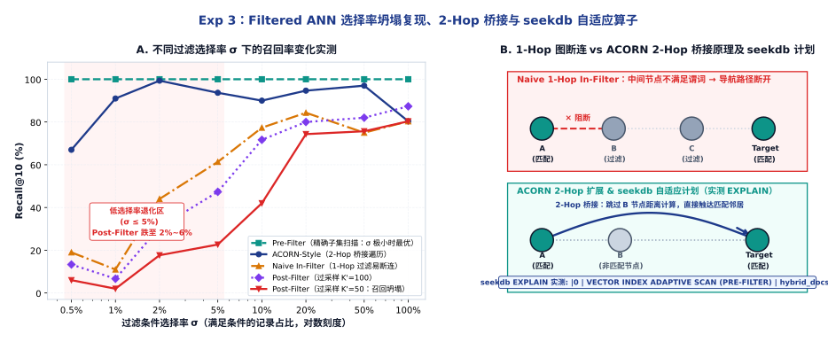
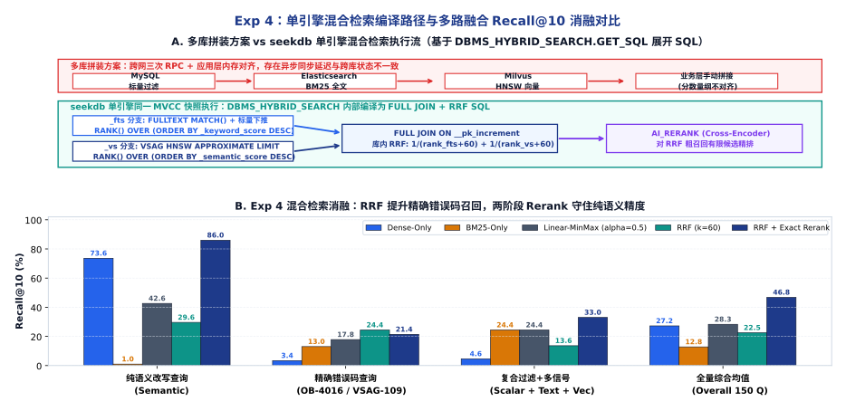
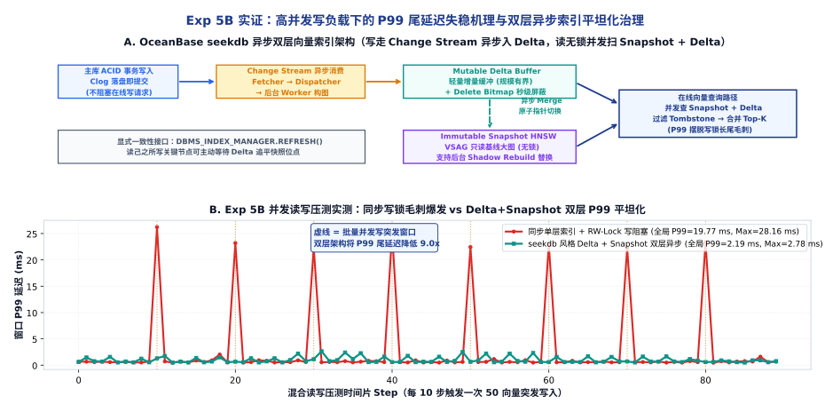

# seekdb-vector-bench

> **Mechanism Verification Benchmark Suite for Vector Databases, Quantization, Filtered ANN, Hybrid RRF, and Dual-Layer HNSW SLOs** — aligned with **OceanBase `seekdb` (`v1.4.1.0`)** and **`antgroup/vsag`**.

[](https://www.python.org/downloads/)
[](LICENSE)
[](https://github.com/oceanbase/seekdb)

---

## 1. Motivation & Design Philosophy

Rather than serving as a generic RAG wrapper or an isolated throughput race, **`seekdb-vector-bench`** is built as a **white-box mechanism verification laboratory**. Every experiment isolates and reproduces a foundational vector database phenomenon or failure mode, and cross-validates it directly against the native **OceanBase `seekdb` Embedded Engine (`pyseekdb` / `pylibseekdb` + `VSAG`)**:

| Experiment | Mechanism Verified | Kernel / Paper Alignment | Key Output |
| :--- | :--- | :--- | :--- |
| **Exp 1** | Curse of Dimensionality, L2/IP/Cosine Unit-Norm Equivalence, SIMD Speedup | `seekdb` `l2_distance` / `cosine_distance` / `inner_product`; `vsag/src/simd` | `results/exp1_curse_of_dimensionality.csv` |
| **Exp 2** | Flat, IVF-Flat, IVF-PQ (ADC+Refine), HNSW, SQ8, **RaBitQ 1-bit** & Live `seekdb` | **SIGMOD 2024 RaBitQ**, **TPAMI 2020 HNSW**, `vsag/src/algorithm/hgraph`, `vsag/src/quantization/rabitq_quantization` | `results/exp2_ann_quantization.csv` |
| **Exp 3** | Filtered ANN Selectivity Collapse ($\sigma \in [0.5\%, 100\%]$) & **ACORN 2-Hop Bridge** | **SIGMOD 2024 ACORN**, **OSDI 2023 VBase**, `seekdb` `VECTOR INDEX ADAPTIVE SCAN (PRE-FILTER)` | `results/exp3_filtered_ann.csv` |
| **Exp 4** | Hybrid Search Fusion: Dense vs BM25 vs Linear Min-Max vs **RRF ($k=60$)** + Rerank | **SIGIR 2009 RRF**, `seekdb` `DBMS_HYBRID_SEARCH.SEARCH` / `GET_SQL`, `src/storage/fts` | `results/exp4_hybrid_fusion.csv` |
| **Exp 5** | Recall–QPS–P99 Trade-off & **Sync RW-Lock vs Async Delta+Snapshot P99** | `seekdb` Change Stream + Delta Buffer + Snapshot HNSW + `DBMS_INDEX_MANAGER.REFRESH()` | `results/exp5_ef_slo_curve.csv`, `results/exp5_p99_timeseries.csv` |



---

## 2. Repository Structure

```text
seekdb-vector-bench/
├── pyproject.toml
├── run_all.py                          # Master runner (Exp 1–5 + live seekdb)
├── src/vector_bench/
│   ├── dataset.py                      # Deterministic CloudInfra multi-modal corpus (N=4,000, D=128)
│   ├── metrics.py                      # Curse of dimensionality, L2/IP/Cosine equivalence, SIMD scan
│   ├── quantization.py                 # SQ8, PQ (ADC LUT), SIGMOD'24 RaBitQ (QR rotation + bitwise popcount)
│   ├── ann_indexes.py                  # Flat, IVF-Flat, IVF-PQ+Refine, white-box HNSW (Algorithm 4)
│   ├── filtered_ann.py                 # Pre-Filter, Post-Filter, Naive 1-Hop In-Filter, ACORN 2-Hop
│   ├── hybrid_fusion.py                # Okapi BM25, Linear Min-Max, Rank-based RRF (k=60)
│   ├── concurrency_slo.py              # ef_search sweep & Sync RW-Lock vs Delta+Snapshot P99 simulator
│   └── seekdb_runner.py                # Live OceanBase seekdb-v1.4.1.0 SQL, VSAG indexes, EXPLAIN & HYBRID_SEARCH
├── experiments/
│   ├── exp1_curse_and_metrics.py
│   ├── exp2_ann_and_quantization.py
│   ├── exp3_filtered_ann_collapse.py
│   ├── exp4_hybrid_rrf_vs_linear.py
│   └── exp5_slo_and_delta_snapshot_p99.py
├── scripts/generate_figures.py         # Generates all 8 publication-grade SVGs
├── results/                            # Reproducible JSON & CSV outputs
├── docs/figures/                       # Generated SVG figures
└── tests/test_mechanisms.py            # Automated invariant test suite (pytest)
```

---

## 3. Quickstart & Reproduction

```bash
# 1. Create Python 3.11+ environment and install dependencies
uv venv --python 3.12 .venv
uv pip install --python .venv/bin/python -e ".[dev]"

# 2. Verify mathematical & algorithmic invariants
.venv/bin/pytest -v

# 3. Run all 5 experiments (including live OceanBase seekdb-v1.4.1.0 embedded engine)
.venv/bin/python run_all.py

# 4. Regenerate SVG figures from results/summary_metrics.json
.venv/bin/python scripts/generate_figures.py
```

---

## 4. Key Empirical Findings

### 4.1 Exp 1: Distance Concentration & Unit-Norm Equivalence
- At $d = 2$, $D_{\min} / D_{\max} = 0.0116$ and KD-Tree axis bounding-box overlap is $2.01\%$. By **$d = 32$**, KD-Tree axis overlap reaches **$100.0\%$** ($D_{\min}/D_{\max} = 0.5070$), and by **$d = 1536$**, $D_{\min}/D_{\max}$ rises to **$0.9132$** (relative contrast drops from `124.29` to `0.0951`).
- On unnormalized vectors (`lognormal` radial norms), `L2` vs `Inner Product` Top-10 overlap is **`0.0%`** and `L2` vs `Cosine` is **`14.7%`**. After L2 unit normalization ($\|x\|_2 = 1$), both NumPy and live `seekdb` SQL (`l2_distance`, `cosine_distance`, `inner_product`) yield **`100.0%`** identical Top-10 rankings ($\text{Kendall-}\tau = 1.0000$).
- Vectorized BLAS/NEON batch scan achieves **`113.2x` speedup** over scalar Python loops (`0.0357 ms` vs `4.0374 ms` per 1,000 vectors).



### 4.2 Exp 2: Quantization Compression Pareto & Live `seekdb` VSAG Indexes
| Implementation / Engine | Footprint (B/vec) | Compression | Recall@10 | QPS | P99 (ms) |
| :--- | :---: | :---: | :---: | :---: | :---: |
| White-box `Flat (FP32 Exact)` | 512.0 | 1.00x | 1.0000 | 5373.5 | 0.215 |
| White-box `SQ8 (8-bit Scalar)` | 128.0 | 4.00x | 0.9250 | 1427.2 | 0.769 |
| White-box `RaBitQ 1-bit` (No Refine) | 24.0 | 21.33x | 0.4317 | 1106.7 | 1.023 |
| White-box `RaBitQ 1-bit + Refine(k=60)` | **24.0** | **21.33x** | **0.8983** | 1316.1 | 0.933 |
| White-box `IVF-PQ (m=16, Refine 5x)` | 20.0 | 25.60x | 0.6417 | 1078.4 | 1.249 |
| White-box `HNSW (M=24, ef=128)` | 712.0 | 0.72x | 0.8983 | 764.4 | 1.438 |
| **Live `seekdb` `HNSW (VSAG FP32)`** | — | — | **0.9400** | 1932.3 | 2.493 |
| **Live `seekdb` `HNSW_SQ (VSAG Int8)`** | — | — | **0.9600** | **2137.7** | 1.445 |
| **Live `seekdb` `HNSW_BQ (VSAG Binary)`** | — | — | **0.9600** | 1925.9 | 1.723 |
| **Live `seekdb` `IVF_PQ (OB)`** | — | — | **1.0000** | 2096.7 | **1.205** |

RaBitQ empirical verification confirms unbiasedness (`mean_signed_bias` within $\pm 0.17\%$ across $d \in [64, 512]$) and $O(1/\sqrt{d})$ error decay (`7.70%` at $d=64$ $\to$ `2.76%` at $d=512$).



### 4.3 Exp 3: Filtered ANN Selectivity Collapse & `seekdb` Adaptive Scan
- At $\sigma = 1\%$ selectivity, `Post-Filter (K'=50)` collapses to **`2.0%` Recall@10** and `Naive 1-Hop In-Filter` collapses to **`11.0%`** due to subgraph disconnection.
- **`ACORN-Style (2-Hop Bridge)`** sustains **`91.0%` Recall@10** at $\sigma = 1\%$ and **`99.3%`** at $\sigma = 2\%$.
- Live `seekdb` `EXPLAIN` on `hybrid_docs` confirms the optimizer switches from `VECTOR INDEX SCAN` (unfiltered) to **`VECTOR INDEX ADAPTIVE SCAN (PRE-FILTER)`** under selective predicates.



### 4.4 Exp 4: Hybrid Search Fusion (`Dense` vs `BM25` vs `Linear` vs `RRF`)
- On exact error-code queries (`OB-4016`, `VSAG-109`), `Dense-Only` achieves only **`3.4%` Recall@10** and `BM25-Only` achieves **`13.0%`**, whereas **`RRF (k=60)` reaches `24.4%`** (nearly doubling single-channel recall and beating `Linear-MinMax` `17.8%`).
- On pure semantic paraphrases, unweighted `RRF (k=60)` drops from `73.6%` (`Dense-Only`) to `29.6%` due to noisy BM25 rank pollution—confirming why **`seekdb` combines `DBMS_HYBRID_SEARCH` RRF recall with `AI_RERANK`** (`RRF + Exact Rerank` lifts semantic Recall@10 to **`86.0%`** and overall Recall@10 from `27.2%` to **`46.8%`**).



### 4.5 Exp 5: `ef_search` SLO Knee & Dual-Layer P99 Governance
- Sweeping `ef_search` from `10` to `384` reveals the production sweet spot at `ef_search = 128` (`Recall@10 = 89.6%`, `QPS = 748.7`, `P99 = 1.51 ms`); pushing further to `384` yields only `+5.1%` recall while cutting QPS by more than half (`331.0`) and inflating P99 to `4.03 ms`.
- Under mixed reads + periodic 50-vector write bursts, a synchronous RW-Lock single HNSW suffers severe read stalls (**`P99 = 19.77 ms`**, `Max = 28.16 ms`), whereas a `seekdb`-style **Async Delta Buffer + Immutable Snapshot HNSW + Tombstone Bitmap** architecture keeps **`P99 = 2.19 ms`** (**9.0x reduction**, `Max = 2.78 ms`).


